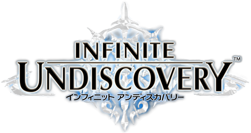

  

<h1 align="center">RECOMP</h1>

A native Windows x64 recompilation of **Infinite Undiscovery** for Xbox 360, built with ReXGlue / XenonRecomp.

This is **Jay-Collins's fork** of [doc-haz's Infinite Undiscovery Recomp](https://github.com/doc-haz/infinite-undiscovery-recomp). Credit for the original recompilation and portable setup goes to doc-haz and the contributors listed below.

This fork fixes the Orb of Patience pedestal interaction in Vesplume Tower: the Examine prompt appears and using the orb opens the door, verified in-game on the reproduction save. [Technical details and validation](docs/ORB-INVESTIGATION.md).

You must supply your own legally obtained game media. Game executables, disc data, DLC packages and saves are not included.

## Downloads and setup

Download the [v1.0.0-rc4 Windows x64 release](https://github.com/Jay-Collins/infinite-undiscovery-recomp/releases/tag/v1.0.0-rc4) for this fork's orb fix, unified menu, save backups, settings restart action, menu pause and save-in-progress protection. The playable ZIP contains no game files, saves or developer diagnostic tools. The separate LGPL source/relink archive is for developers and is not needed to play.

Requirements for the Windows build:

- 64-bit Windows 10 or Windows 11.
- A Direct3D 12 capable GPU.
- Microsoft Visual C++ Redistributable 2015–2022 (x64).

To use a portable build:

1. Extract it to a writable folder and run `InfiniteUndiscoveryRecomp.exe`.
2. Select your Disc 1 media in the Asset Setup Wizard. It accepts supported XDVDFS ISO images or extracted disc folders containing `default.xex`, `ud1.bin` and `ud2.bin`.
3. Add Disc 2, either during initial setup or later through the Content Profile Manager. It is needed for later progression.
4. Optionally import your **A Voucher** and **B Voucher** DLC packages in STFS format.

The wizard validates the media and identifies its edition automatically. Supported profiles are **USA, USA-UNDUB, EUROPE, JAPAN and ASIA**; arbitrary modified media or other undub variants are not guaranteed to pass validation. Setup and the Content Profile Manager offer English and Spanish; the F4 overlay is currently in English.

See [Asset Setup](ASSET_SETUP.md) for the detailed workflow and troubleshooting.

## Saves and portable data

Each content profile stores its assets, saves, shaders, cache, logs and configuration under the application folder. For example, the USA profile's saves are in `USA/saves/`. Profiles do not share saves automatically; moving the complete application folder preserves its portable data.

The game automatically backs up existing save slots at launch and changed slots when the game closes their save container. Backups live in `<profile>/backups/saves/`, include the slot's files and content header, and retain the latest 10 distinct versions per slot. Unchanged saves do not create duplicate versions. These are copies of saved progress, not autosaves or save states.

Use **F4 → Game → Save backups** to choose a timestamped backup and **Restore and restart**. Only that slot is replaced, after the old game process exits. The current slot is copied first; this recovery copy may temporarily exceed normal retention. Interrupted restores roll back at the next launch. Backup integrity is checked, but this does not establish that the game's saved progress is valid. Empty/incomplete recovery copies are retained for inspection and cannot be restored through the menu. Backups stay within their content profile, and only one game session can use a profile at a time.

[IU Save Bridge](https://github.com/doc-haz/iu-save-bridge) is the original project's separate save editor, with Xbox 360 / STFS save import and backup tools. Save compatibility between editions should not be assumed.

## Utility controls

Open the unified menu with **F4** or **Back + Start** on an Xbox-compatible controller. The controls, tabs and save-in-progress protection below are included in **v1.0.0-rc4**.

| Shortcut | Action |
| --- | --- |
| **F4** | Open or close the menu |
| **Back + Start** | Open or close the same menu using a controller |
| **F7** | Open the menu's Achievements tab |
| **F10** | Return to the Content Profile Manager, after confirmation |
| **F12** | Quit the game, after confirmation |

Use the **D-pad or left stick** to navigate, **A** to select, and **B** to back out of a selection. Confirmation dialogs provide a **Cancel** button. Menu navigation always uses the original controller layout, even if gameplay buttons are remapped. Mouse and keyboard navigation are also available. To resume gameplay, press **F4**, press **Back + Start**, or select **Return to game**.

| Tab | Available options |
| --- | --- |
| **Settings** | Display and monitor selection, aspect ratio, display and internal resolution, UI scale, FPS/frame-time display, 30/60 FPS target, VSync, anti-aliasing, dithering, master volume and mute |
| **Controls** | Controller button mapping, stick deadzones, vibration strength, stick swapping, camera Y inversion, keyboard/mouse emulation, mouse sensitivity and keyboard bindings |
| **Achievements** | Achievement list, search, unlocked-only filter, unlock count and earned gamerscore |
| **Game** | Current content profile, timestamped save backups, restore and restart, Content Profile Manager and quit actions |

Opening any tab requests a gameplay pause at the next frame boundary and blocks gameplay input. Closing the menu resumes play. Background music continues; the footer indicates when the game has paused.

### Saving settings and restarting

- **Save settings** keeps changes for the active content profile. Closing the menu alone does not save them.
- **Save settings and restart...** appears when a changed setting requires a restart. After confirmation, it saves settings and relaunches the same content profile. A settings-write or launch failure leaves the current session running.
- **Reset this tab** restores defaults for Settings or Controls after confirmation. Use **Save settings** afterward to keep those defaults.
- **Game → Save backups → Restore this backup...** lets you choose a saved version, then confirm **Restore and restart**. See [Saves and portable data](#saves-and-portable-data) for retention and recovery behavior.

**Saving settings does not save game progress.** Save normally in the game and wait for saving to finish before restarting, switching profiles or quitting. Settings marked with an asterisk require a restart.

### Display and frame rate

- **Aspect ratio** preserves the original picture or stretches it to the display; it does not add an ultrawide field of view.
- **Display resolution** controls window size. Borderless fullscreen uses the desktop resolution.
- **Internal resolution** offers uniform **1–8×** native rendering scale, independent of window size. Save settings and restart to apply it.
- **Frame rate** offers **30 FPS (original)** or **60 FPS (experimental)** and requires a restart. Keep VSync enabled. First-use shader/asset hitches may remain; videos retain their own playback rate.

### Save-in-progress protection

Restart, backup restore, profile switching and normal quit are blocked while save data is in use, including queued save opens and automatic backup completion. This also covers **F10/F12**, **Alt+F4** and the window close button. The menu explains why actions are unavailable; retry after the operation finishes. Blocked exit requests are not queued.

If F4 is open, active save/load work is allowed to finish before gameplay pauses. This protection was added in **rc4**. [Implementation and validation](docs/SAVE-EXIT-PROTECTION.md).

Public builds omit the developer diagnostic/recovery menu, Save Anywhere, Safe Step and trace recorders. SDK debug-overlay and console shortcuts are unregistered; normal runtime error logging remains available.

## Compatibility

Save backups, settings restart, menu pause and the newer save-in-progress protection pass automated host tests. Their in-game integration, including pause behavior during cutscenes, still needs verification. Full-game compatibility of the experimental 60 FPS option is also unverified.

Full-game completion and later Disc 2 progression have not been verified in this fork. The [upstream release notes](https://github.com/doc-haz/infinite-undiscovery-recomp/releases/tag/v1.0.0-rc1) report a successful in-game Disc 1 to Disc 2 transition; we have not independently repeated that test here.

DLC installation is implemented, but complete in-game verification of both vouchers' effects remains outstanding. Hardware-specific rendering issues, unusual aspect ratios and later-game bugs may still occur.

## Building from source

A developer build needs a supported game executable, the ReXGlue SDK, CMake 3.25 or newer, Ninja, Clang with C++23 support, and the MSVC / Windows SDK environment.

The SDK is pinned to **ReXGlue v0.10.0**, revision `f5337cdc947ff6d4c4196737e2c807a48f2a1fc2`, with the checked-in content-header patch for imported save enumeration. SDK DLL hashes are recorded and checked during the build and packaging process.

See [Windows build instructions](docs/LOCAL-BUILD.md) for toolchain setup, SDK compilation, code generation and release packaging. The SDK, generated game code and proprietary game data are excluded from this repository.

Developer tools can be enabled with `IU_ENABLE_DIAGNOSTICS=ON`; `build-local.ps1` enables them for local investigation. They are disabled by default and in `release/make-release.ps1`.

[Project History](PROJECT_HISTORY.md) preserves the upstream development timeline.

## Credits

This project builds on work from the Xbox 360 recompilation community.

Special thanks to:

- **Magna** — for major help with development, testing, portability, the Asset Setup Wizard, localization and preparing the portable build.
- **Premium** — for development help and support throughout the project.
- **Diesel** — for extensive help with source auditing, ReXGlue rebuild verification, ABI compatibility checks, release engineering, compliance validation and final RC1 preparation.
- **[vs-sr-dev / pc-infiniteundiscovery](https://github.com/vs-sr-dev/pc-infiniteundiscovery)** — for extensive reverse-engineering research, documentation and analysis tools for Infinite Undiscovery and the ASKA engine.
- **[dotslash (freefrank) / LostOdysseyRecomp](https://github.com/freefrank/LostOdysseyRecomp)** — for the Lost Odyssey native PC recompilation project and its importer and portable workflow, which were useful references during development.
- **ReXGlue / XenonRecomp contributors** — for the tooling and groundwork that make projects like this possible.
- Everyone testing the recomp, reporting bugs, providing saves and documenting reproduction cases.

## License and attribution

The project code is licensed under the [BSD-3-Clause license](LICENSE). Third-party notices and license texts are in [THIRD_PARTY_NOTICES.txt](THIRD_PARTY_NOTICES.txt) and [LICENSES](LICENSES/). The release page also provides the matching LGPL source/relink archive for the shipped runtime binaries.

Infinite Undiscovery and its logo belong to their respective rights holders. This project is unofficial and is not affiliated with or endorsed by Square Enix, tri-Ace or Microsoft. The code license does not grant rights to the game, its artwork or external dependencies.
